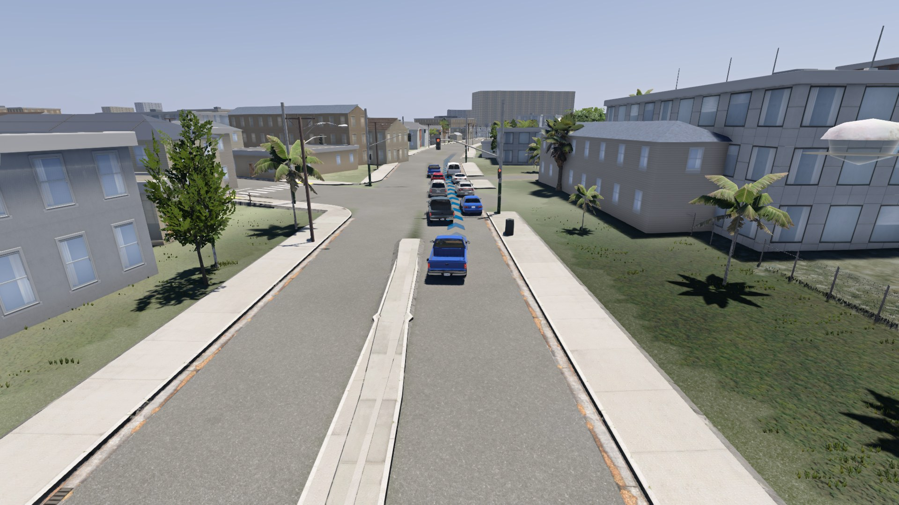
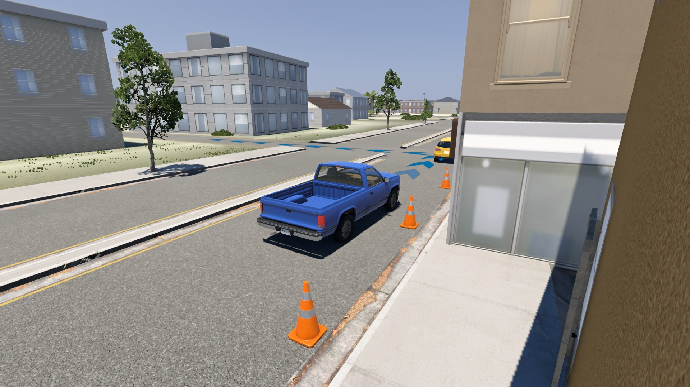
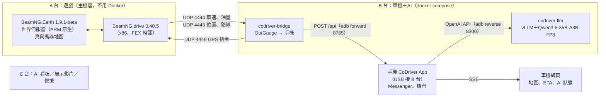

# CoDriver：會主動開口、會幫你動手的 AI 副駕駛

**CoDriver 在 NVIDIA DGX Spark 上執行：駕駛模擬、車機、AI 模型都在 DGX 本機，不靠雲端。**

上車後，CoDriver 從你真的 Messenger 聊天裡找出今天的約定，幫你規劃導航。路上塞車時它會主動問：「你大概會晚 8 分鐘，要幫你跟孟澤說嗎？」你說「送出」，它才真的在 Messenger 把訊息傳出去。



抵達：路邊的三角錐和黃車標出目的地，畫面上方顯示「【已抵達】楠梓車站麥當勞」。



<!-- TODO 車機網頁截圖（地圖＋AI 怎麼想）：docs/images/dash.jpg，手機連上後補 -->

## 展示故事

1. **上車**：CoDriver 讀 Messenger 聊天，找出今天跟孟澤的約定，問你要不要導航過去。
2. **導航**：手機規劃路線，遊戲裡的路面同時出現導航箭頭（高雄真實地圖）。
3. **塞車**：前方車道被故障車擋住、車流排隊。CoDriver 從車速和前車判斷塞住了，**主動開口**問要不要通知對方會晚到。
4. **送出**：駕駛說「送出」，才在 Messenger 按下「傳送」。沒有確認就不會送出。
5. **抵達**：路邊出現三角錐、畫面顯示「已抵達」。

## 架構（三台 DGX Spark 分工）



- **A 台**：Steam（背景）、BeamNG.drive 原生 Linux 版（x86_64，用 FEX 轉譯到 ARM）、BeamNG.Earth 世界伺服器。BeamNG 的 CEF 介面在 FEX 下會當掉，所以用 `-noui` 執行，改用自製 mod 和 `bng` 指令、遊戲內快速鍵操作。
- **B 台**：`codriver-llm`（本機 LLM）和 `codriver-bridge`（遊戲資料轉給手機、手機導航同步回遊戲）。手機用 USB 接這台。
- **C 台**：AI 看板、展示影片；需要時當 A 或 B 的備援。
- 開發和測試時 A、B 可以在同一台（單機模式，全部用 127.0.0.1）。

## 硬體需求（實測）

每台都是 **NVIDIA DGX Spark**（GB10、128 GB 統一記憶體、Ubuntu 24.04 arm64）。**實測 2 次，雙機與單機分工的結果一致**，每台取兩次量測的最大值：

| 機器 | 跑什麼 | GPU 功耗 最大 | 整台記憶體 最大 | 整機功耗上限 | 遊戲 FPS |
|---|---|---|---|---|---|
| **#1 遊戲台** | BeamNG＋Earth 高雄＋10 台交通車＋塞車＋Moonlight 串流 | **43.3 W** | **28.2 GB** | 240 W（變壓器額定） | 平均 59.5 |
| **#2 車機＋AI 台** | Qwen3.6-35B-A3B（vLLM）＋橋接，含 10 分鐘壓力測試 | **38.6 W** | **57.3 GB** | 240 W（變壓器額定） | — |

兩次量測的明細：

| 量測 | #1 遊戲台 GPU 平均／最大、記憶體最大 | #2 AI 台 GPU 平均／最大、記憶體最大 |
|---|---|---|
| 11/18 單機分工（同一台輪流只跑 A 或 B 的部分，B 含壓力測試） | 35.1／39.3 W、27.9 GB | 19.4／38.6 W、57.3 GB |
| 11/19 雙機實測（兩台同時，真實手機完整故事 2 輪，#1 全程 Moonlight 串流） | 36.2／43.3 W、28.2 GB | 9.2／33.6 W、55.4 GB |
| idle（基準） | 11.0 W、5.5 GB | 3.0 W、4.5 GB（沒接顯示器） |
| 備案：單機全開（A＋B 同一台） | 35.9／46.6 W、78.3 GB，FPS 55.9 | （同左） |

- **整機功耗**：DGX Spark 沒有整機功耗感測器（`nvidia-smi` 的 Module Power 是 N/A，DGX Dashboard 只有 GPU 使用率和記憶體），表上是 GPU 功耗。整機以原廠變壓器額定 **240 W** 為上限，另以插座型電表實測。
- #1 的 GPU 最大值來自雙機實測：全程有 Moonlight 遠端看畫面（Sunshine 用 GPU 編碼）。
- #2 的記憶體大部分是 vLLM 預先保留的（`CODRIVER_LLM_GPU_MEM=0.40`：模型 34.5 GiB＋KV 快取），跟請求多寡無關。
- FPS 的低點都在每輪開頭（傳送回起點、交通車重新分布）；開車途中 55～60。
- LLM（App 真正的提示詞）：

| 情境 | 次數 | 正確率 | 延遲 平均／P95 |
|---|---|---|---|
| B 台，展示頻率（每 10 秒一句） | 120 | 100% | 1.02／1.35 秒 |
| B 台，壓力測試（4 個連線連續發，每分鐘 98 句） | 987 | 100% | 2.44／3.50 秒 |
| 單機全開（遊戲同時在跑） | 84 | 100% | 1.63／2.2 秒 |

## 部署

完整步驟、雙機設定、量測方法在 **[tools/dgx/README.md](tools/dgx/README.md)**；會場要帶的資料與檢查項目在 **[tools/dgx/DEPLOY_CHECKLIST.md](tools/dgx/DEPLOY_CHECKLIST.md)**。

### 第一層：A 台主機層（遊戲）

```bash
# 事前：Sunshine（遠端看桌面）、Steam snap 登入、BeamNG 遊戲檔放進 Steam 資料夾（見 tools/dgx/README.md）
tools/dgx/install_host.sh        # FEX 設定、BeamNG.Earth＋ARM venv、codriver mod
echo "RELAY_TO=<B 台 IP>" > ~/codriver-dgx/local.conf   # 雙機：遊戲 → 本機轉送 → B 台（會場預設）
tools/dgx/start_codriver.sh      # 一鍵啟動：Steam → Earth → BeamNG → 高雄起點 → GPS → 10 台交通車（約 2 分鐘）
tools/dgx/bng status             # 位置、FPS、OutGauge 目標
```

遊戲內快速鍵：**Ctrl+Alt+1** 塞車開／關、**Ctrl+Alt+2** 回起點、**Ctrl+Alt+3** 車放回路上、**Ctrl+Alt+4** 交通車重生、**Ctrl+Alt+5** 自動駕駛開／關。操作員小抄：[tools/dgx/OPERATOR_CHEATSHEET.md](tools/dgx/OPERATOR_CHEATSHEET.md)。

### 第二層：B 台 docker compose（AI＋橋接）

```bash
cp .env.example .env                       # 模型、port、雙機設定（.env 不進 git；金鑰只放這裡）
docker compose up -d                       # codriver-llm（約 5 分鐘載入）＋ codriver-bridge
python3 tools/dgx/llm_bench.py --rounds 1  # 用 App 真正的提示詞測正確率與延遲
adb forward tcp:8765 tcp:8765 && adb reverse tcp:8300 tcp:8300   # 手機 USB 接上後
```

車機網頁：`http://localhost:8765/?unit=1`（Chromium）。

## 模型

| 項目 | 內容 |
|---|---|
| 模型 | [Qwen3.6-35B-A3B-FP8](https://huggingface.co/Qwen/Qwen3.6-35B-A3B-FP8)（MoE，350 億參數，每個 token 只用約 30 億；FP8） |
| 授權 | Apache-2.0 |
| 推論 | NVIDIA NGC vLLM 26.10（`nvcr.io/nvidia/vllm:26.10-py3`，arm64），OpenAI 相容 API |
| 用途 | 指令判斷（導航、通知晚到、送出、聊天…）、路由（車機／App）、主動提問 |
| 實測 | 指令判斷 24/24 正確、平均 1.65 秒；路由 8/8、0.51 秒（遊戲同時在跑） |
| 備用 | Qwen3-8B（BF16，Apache-2.0），平均 4.3 秒 |

## 安全設計

- Messenger 送出前一定要駕駛確認；程式只會按說明文字完全等於「傳送」的按鈕，**永遠不碰「發送👍」**。
- 金鑰只放 `local.properties`（Android）或 `.env`（Docker），不進 git。

## Repo 結構

| 路徑 | 內容 |
|---|---|
| `app/src/drive/` | CoDriver（Android，Product Flavor `drive`） |
| `app/src/main/` | 兩個版本共用的程式 |
| `tools/dgx/` | DGX 部署：安裝／啟動腳本、`bng`、BeamNG mod、量測工具、部署清單 |
| `tools/beamng/` | 橋接程式 `beamng_bridge.py`、地點表 `places.json` |
| `docker-compose.yml`、`.env.example` | B 台容器 |

Android App 用 Android Studio 編譯，Build Variant 選 `driveDebug`。

---

## 另一個版本：交友大師（暫停中）

同一個 repo 的 Product Flavor `friend`（`app/src/friend/`）是「交友大師」：讀聊天內容，幫你記住對方說過的事、聊天前給小抄、提醒重要的日子。目前專案重點是 CoDriver，交友大師暫停開發。
